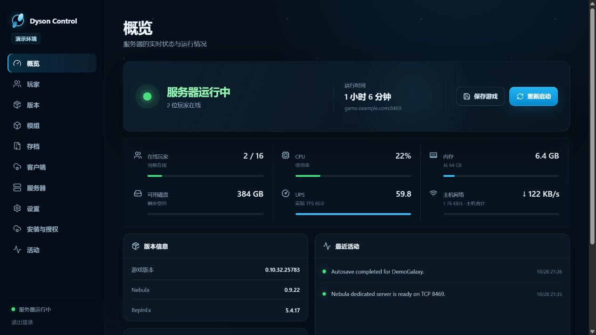
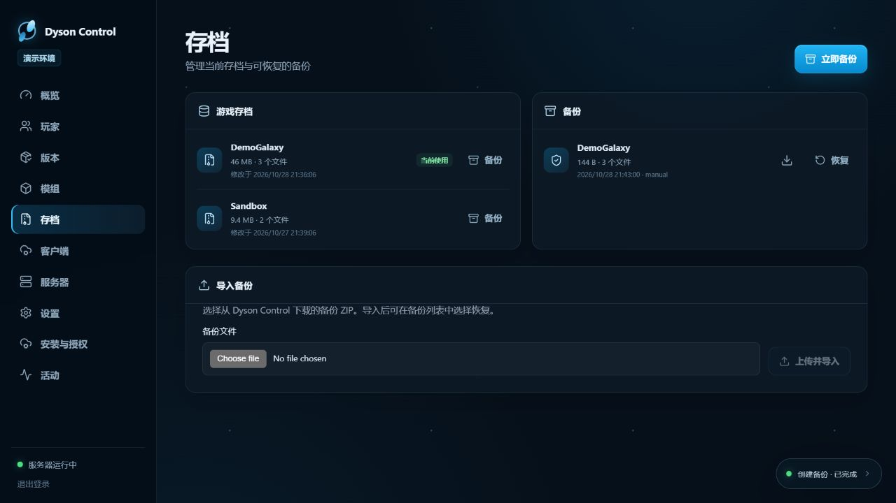

<div align="center">

# Dyson Control

**在自己的 Windows 主机上搭建戴森球计划联机服务器，用浏览器管理。**

启动与保存、存档备份、Steam 授权、模组更新和玩家管理，集中在一个中文面板里。每个部署实例使用自己的游戏目录、Steam 账号、存档和连接地址。

[](https://github.com/mikutea/dyson-control/actions/workflows/ci.yml)
[](#运行要求)
[](#快速体验)
[](LICENSE)

[功能](#功能) · [快速体验](#快速体验) · [部署服务器](#部署服务器) · [文档](#文档) · [已知限制](#已知限制)

</div>



*截图来自演示模式，展示实际页面与操作入口；其中的玩家、存档、版本和指标均为示例。*

> **当前版本状态**：本分支为 `0.1.10` 候选版，包含新的安装与 Steam 授权流程。截至 2026-10-28，默认 `main` 仍为 `0.1.7`，仓库尚无公开 Release。可按下方从源码体验；最新改动见 [PR #4](https://github.com/mikutea/dyson-control/pull/4)。

## 功能

| 想做什么 | 面板提供什么 |
| --- | --- |
| 开服和日常维护 | 启动、游戏内保存、正常停止、重启；查看操作进度与历史 |
| 保护与切换存档 | 将 `.dsv`、同名 `.server` 和已有 `.moddsv` 整组备份、下载、导入和恢复；可单独校验备份完整性，加载已有存档前自动保存与备份 |
| 准备新服务器 | 在“安装与授权”中准备 SteamCMD、完成 Steam 登录，并向空目录安装游戏、Nebula 与所需依赖 |
| 管理游戏与模组版本 | 查询与安装更新、锁定版本、检查依赖、编辑模组配置，并查看变更与回滚记录 |
| 让玩家加入 | 查看在线玩家和加入/离开记录，踢出指定连接，生成可用 r2modman 导入的 `.r2z` 客户端配置包 |
| 观察运行情况 | 查看日志、CPU、内存、磁盘、UPS、TPS 与网络速率；定时备份、异常退出恢复和持续零 TPS 告警 |

面向一位管理员设计，支持手机、平板与桌面浏览器。面板服务与实际游戏运行在同一台 Windows 主机；游戏内控制由随版本匹配的 Dyson Control Bridge 完成。

<details>
<summary>查看存档管理界面</summary>



</details>

## 快速体验

准备 Node.js 24 或更新版本及 Git。在终端运行：

```powershell
git clone --branch codex/steam-onboarding --single-branch https://github.com/mikutea/dyson-control.git
cd dyson-control
npm ci
npm run admin -- init-demo
npm run build
npm start
```

按提示设置至少 12 字符的管理员密码，然后打开 [http://127.0.0.1:13020](http://127.0.0.1:13020)。

这条命令获取当前候选分支。演示模式会生成示例数据，页面有“演示环境”标识，可以体验操作流程；它不会连接你的真实游戏。私有配置保存在 `control.config.json`，运行数据保存在 `.data/`。

## 部署服务器

### 运行要求

- Windows 10（1809+）/ Windows Server 2019 或更新版本，Windows PowerShell 5.1。
- Node.js 24 或更新版本及配套 npm。
- 拥有戴森球计划的 Steam 账号；空目录首装会下载 Nebula 与所需依赖。
- 实际游戏用户需要保持 Windows 登录，并运行已登录的桌面 Steam。SteamCMD 的下载授权与桌面 Steam 的游戏运行条件分别检查。

### 选择你的安装方式

| 使用场景 | 从这里开始 |
| --- | --- |
| 已有游戏和存档 | [安装面板](docs/installation.md#首次安装)，再按[游戏与 Bridge 接入](docs/game-configuration.md)绑定现有目录 |
| 从空目录准备新服 | [交互生成私有配置](docs/installation.md#准备私有配置)并安装完整面板包，再打开[安装与 Steam 授权](docs/server-setup.md)完成首装 |
| 升级已有面板 | 按[升级与自动回退](docs/installation.md#升级与自动回退)更新程序；游戏与存档继续使用原目录 |
| 从源码准备发布包 | 按[生成发布包](docs/installation.md#生成发布包)构建完整包或仅面板包 |

**完整包**包含匹配的 Bridge，支持首次安装服务器；**仅面板包**用于已有部署的面板更新或 Steam 授权，不提供空目录首装所需的 Bridge。当前尚无公开 Release，源码构建与打包步骤见上述文档。

安装面板、准备游戏、启动游戏是三个明确的步骤。安装完成后，由管理员在概览页启动；已有存档会按选择加载，首次空存档目录会创建默认世界。

### 连接地址

项目可独立部署，管理与游戏地址均由部署者自行配置。管理面板默认监听 `127.0.0.1:13020`，远程管理使用你配置的 HTTPS 入口。玩家通过你自己的 **Nebula 游戏地址与端口**加入，常用端口为 `8469`。

配置中的 `game.example.com:8469` 是占位示例，请改成你的主机地址。局域网联机、公网端口转发及管理入口的配置见[连接自己的服务器](docs/networking.md)。

## 文档

| 内容 | 指南 |
| --- | --- |
| 安装、升级、卸载 | [Windows 安装指南](docs/installation.md) |
| Steam 登录、下载授权、空目录首装 | [安装与授权](docs/server-setup.md) |
| 接入现有游戏与存档 | [游戏与 Bridge 配置](docs/game-configuration.md) |
| 局域网、公网联机与远程管理 | [连接自己的服务器](docs/networking.md) |
| 游戏和面板更新 | [Steam 游戏更新](docs/steam-updates.md) · [面板自身更新](docs/control-updates.md) |
| 模组与客户端需求 | [模组适用端](docs/mod-requirements.md) · [版本锁定](docs/version-locks.md) |
| 监控、自动备份、恢复和玩家历史 | [后台运行说明](docs/monitoring.md) |
| 开发与接口 | [架构](docs/architecture.md) · [Bridge 协议与能力](docs/bridge.md) |
| 项目目标与实际验证 | [产品目标](GOAL.md) · [实际验收说明](docs/acceptance.md) |

## 已知限制

- **无人时持续模拟**：在已测的游戏 `0.10.35.29151` / Nebula `0.9.24.2` 组合中，关闭无人暂停后仍出现无人时 tick 停止。当前面板会报告持续零 TPS，尚未修补这一上游行为；有离线持续生产需求的服务器需要先处理此问题。
- **重启后的游戏启动**：当前游戏运行依赖已登录的桌面 Steam。Windows 重启后无需人工登录的整机恢复尚未验证，不能承诺完全无人值守。
- **模组与性能**：不同模组组合、玩家数和工厂规模会影响兼容性与 UPS；当前一小时单客户端轻载结果不能用于承诺多人或大型工厂性能。
- **接口范围**：当前 Nebula 没有提供的名单和角色权限功能不作模拟实现；具体支持范围见 [Bridge 说明](docs/bridge.md)。

2026-10-28 的验证已覆盖真实 Windows 首装、空存档首启、保存与重载、两种存档恢复、异常自动恢复，以及真实客户端踢出与重连。另完成单客户端 60 分钟持续推进和定时备份。具体联机地址与网络连通性由各部署者在自己的环境中配置和检查。

长时间压测、恒定 60 UPS、完整玩法模组组合和报告截图可继续完善；首版按已验证功能和这里列明的限制交付。

## 常见问题

**需要把存档迁移到面板目录吗？**

不用。配置现有游戏、存档和备份的绝对路径即可，程序版本与持久化数据分开保存。

**有 SteamCMD 登录，为什么还需要桌面 Steam？**

SteamCMD 负责下载和版本查询；本项目当前的游戏运行流程还会检查游戏用户的桌面 Steam 状态。

**客户端配置包里包含游戏吗？**

不包含。`.r2z` 记录模组和配置，玩家用 r2modman 导入时仍需下载对应模组，并自行安装正版游戏。

## 开发与参与

界面开发时分别运行 `npm run dev` 与 `npm run dev:web`，然后访问 `http://127.0.0.1:5174`。

```powershell
npm run typecheck
npm test
npm run build
```

欢迎提交 [Issue](https://github.com/mikutea/dyson-control/issues) 或 Pull Request。报告问题时写明面板、游戏和 Nebula 版本、操作步骤与错误信息，并移除密码、密钥、玩家资料和真实存档。

## 致谢与许可

Dyson Control 使用 [GPL-3.0](LICENSE) 许可。游戏联机能力依赖 [Nebula](https://github.com/NebulaModTeam/nebula) 与 [BepInEx](https://github.com/BepInEx/BepInEx)，客户端配置包供 [r2modman](https://github.com/ebkr/r2modmanPlus) 导入；各项目保留其自身许可。
