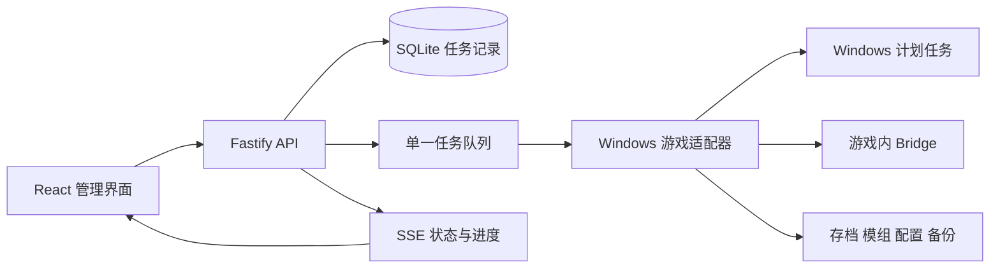

# 架构

Dyson Control 使用一个 Node.js 服务承载 API、静态网页、管理员会话和持久化任务队列。React 界面只调用该服务。Windows 游戏适配器负责实际进程、计划任务、游戏内保存、文件与配置操作。

`shared/contracts.ts` 定义两端共用的响应和操作类型。每个页面以相应 API 数据为准；演示适配器独立运行且明确标识，不能作为生产验收结果。

## 执行约定

管理员提交操作后即获得任务。任务依次运行，进度与结果持久化，页面通过 SSE 更新。重复的请求标识返回原任务。进程意外退出后的未完成任务保留为中断状态，不自动重新执行。

API 校验输入与会话，游戏适配器确认操作所需的真实状态。修改存档时将完整存档集作为单位，替换前先创建恢复副本。脚本通过固定入口和结构化参数执行，不接受网页提交的任意命令。

## 数据与源码

运行配置、管理员密码散列、会话数据库、任务记录、备份和游戏文件均为运行数据，不进入发布源码。游戏和存档保留在部署者选择的持久化目录，面板源码目录不接管它们。

`server/` 为服务端，`server/game/` 为游戏适配器，`web/` 为界面，`scripts/` 为受控系统操作，`docs/` 为安装与运维说明。每项功能只有一个执行入口。
